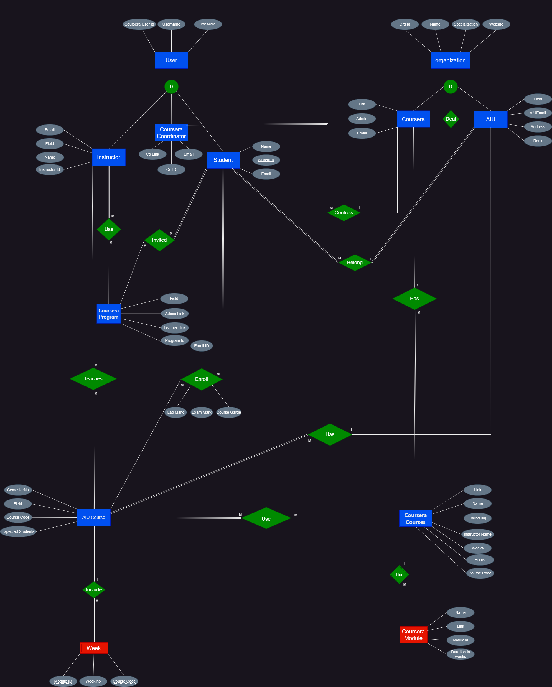

# AIU Coursera Course Management Database

> **Academic Database Project** — CSE221: Database Systems | Al Alamein International University (AIU) | Spring 2024

A normalized relational database system designed to manage the integration of Coursera online courses into AIU's academic programs across 8 university faculties. The system maps internal academic course codes to external Coursera course slugs, tracks student enrollments, manages weekly module scheduling, and supports faculty-level reporting on license usage and course completion.

---

## 📋 Table of Contents

- [Project Overview](#project-overview)
- [Database Schema](#database-schema)
- [Entity-Relationship Diagram](#entity-relationship-diagram)
- [SQL Objects](#sql-objects)
- [Repository Structure](#repository-structure)
- [Getting Started](#getting-started)
- [Key Design Decisions](#key-design-decisions)
- [Technologies Used](#technologies-used)
- [Limitations](#limitations)
- [Author](#author)

---

## Project Overview

**Problem:** Al Alamein International University (AIU) integrated Coursera into its degree programs across 8 academic faculties (CSE, Pharmacy, Dentistry, Business, Engineering, Art & Design, Public Health, Basic Sciences). The university needed a centralized system to:

- Map internal AIU course codes to external Coursera course slugs and weekly modules
- Track student invitations and program enrollments
- Monitor seat license usage against university quotas
- Generate weekly and semester-level aggregate reports for faculty coordinators
- Log student academic marks and grades across enrolled courses

**Solution:** A fully normalized MySQL relational database (18 tables, 10 views, 10 stored procedures) modeling the complete lifecycle of AIU–Coursera course integration.

**Target Users:**
| Role | Access Level |
|---|---|
| Main Coursera Coordinator | Full administrative visibility across all faculties |
| Field / Department Coordinator | Visibility restricted to their academic field |
| AIU Course Instructor | Visibility over assigned courses and Coursera mappings |
| AIU Student | Enrolled learner access |

---

## Database Schema

The database consists of **18 normalized tables** covering users, institutions, courses, instructors, students, programs, and weekly scheduling.

### Core Entities

| Table | Description |
|---|---|
| `User1` | Coursera user accounts (students, instructors, coordinators) |
| `Org` | External Coursera partner organizations (e.g., UC San Diego, LearnQuest) |
| `Coursera` | Coursera platform entry linked to partner organizations |
| `AIU` | AIU university record with ranking and Coursera link |
| `AIUAddress` | Separated address table (3NF normalization) |
| `AIUCourses` | Internal AIU academic courses by semester, field, and expected enrollment |
| `CourseraCourses` | External Coursera course catalog (slug, name, instructor, weeks, hours) |
| `Instructor` | AIU faculty instructors linked to Coursera user accounts |
| `Student` | AIU student records linked to Coursera accounts |
| `CourseraProgram` | Coursera programs/specializations with admin and learner links |
| `CourseraCoordinator` | Coursera coordination staff linked to the platform |
| `CourseraModule` | Individual course modules with durations |

### Junction / Relationship Tables

| Table | Relationship |
|---|---|
| `Use1` | Many-to-many: AIU Courses ↔ Coursera Courses |
| `Teaches` | Many-to-many: Instructors ↔ AIU Courses |
| `Use2` | Many-to-many: Instructors ↔ Coursera Programs |
| `Invite` | Many-to-many: Students ↔ Coursera Programs |
| `Enroll` | Student enrollment in AIU courses with lab mark, exam mark, and grade |
| `Map` | Weekly syllabus mapping: week number ↔ module ↔ course ↔ instructor |

### Sample DDL

```sql
-- AIU Courses Table
CREATE TABLE AIUCourses (
    AIUCourseCode VARCHAR(255) PRIMARY KEY,
    AIUCourseName VARCHAR(255),
    AIUEmail      VARCHAR(255),
    SemesterNo    INT,
    Field         VARCHAR(255),
    ExpectedStudentsNo INT,
    FOREIGN KEY (AIUEmail) REFERENCES AIU(AIUEmail)
);

-- Enrollment Table
CREATE TABLE Enroll (
    EnrollID       INT PRIMARY KEY,
    StuID          INT,
    AIUCourseCode  VARCHAR(255),
    CourseLabMark  INT,
    CourseExamMark INT,
    AIUCourseGrade VARCHAR(255),
    FOREIGN KEY (StuID)         REFERENCES Student(StuID),
    FOREIGN KEY (AIUCourseCode) REFERENCES AIUCourses(AIUCourseCode)
);
```

---

## Entity-Relationship Diagram

The full EER diagram was modeled using Draw.io and is available in the [`diagrams/`](./diagrams/) folder.



---

## SQL Objects

### Views (10)

| View | Description |
|---|---|
| `CourseEnrollmentCount` | Student count per AIU course using `LEFT JOIN` |
| `CourseraCourseInstructors` | Coursera courses joined with instructor data |
| `CourseraProgramEnrollmentCount` | Total enrollments per Coursera program |
| `StudentsEnrolledInProgram` | Student details filtered by program ID |
| `StudentAverageExamMarks` | Average exam mark per student using `AVG()` |
| `AiuCoursesInField` | AIU courses filtered by academic field |
| `AiuInstructorsInField` | Unique instructors per field using `DISTINCT` |
| `CourseraCoursesWithDurationGreaterThan5` | Courses with module duration > 5 |
| `OrgOfferingAiuCourses` | Organizations joined to AIU courses |
| `CoursesTaughtByInstructor` | Courses filtered by a specific instructor |

### Stored Procedures (10)

Ten MySQL stored procedures using `DELIMITER //` syntax wrapping the above views for business-logic encapsulation. Example:

```sql
DELIMITER //
CREATE PROCEDURE GetStudentAverageExamMarks()
BEGIN
    SELECT * FROM StudentAverageExamMarks;
END //
DELIMITER ;
```

### SQL Techniques Demonstrated

| Technique | Used |
|---|---|
| `CREATE TABLE` / DDL | ✅ |
| `INSERT INTO` / DML | ✅ |
| `CREATE VIEW` | ✅ |
| `CREATE PROCEDURE` | ✅ |
| `INNER JOIN` / `LEFT JOIN` | ✅ |
| `GROUP BY` | ✅ |
| `AVG()` / `COUNT()` | ✅ |
| `DISTINCT` | ✅ |
| `WHERE` filtering | ✅ |
| MySQL `DELIMITER` | ✅ |

---

## Repository Structure

```
AIU-Coursera-Course-Management-DB/
├── datasets/
│   ├── Raw Data/
│   │   └── Data for Coursera Project/    # Real Coursera catalogs & student sheets (8 faculties)
│   └── Processed Data/
├── description/
│   └── CSE221 Project Topic and Deadlines.pdf
├── diagrams/
│   ├── ERD.png                           # Exported EER diagram
│   ├── Project DB.drawio                 # Draw.io source file
│   └── Project DB.drawio.png
├── docs/
│   ├── DB Project.docx                   # Technical report (normalization, business rules)
│   ├── DB Project 1.docx                 # Extended report with functional dependency analysis
│   ├── DB Project2.docx
│   ├── DB project2.pptx                  # Presentation deck
│   └── DB Project.txt                    # DDL + DML SQL (text copy)
├── queries/
│   ├── DB Project.sql                    # Main schema DDL + seed data DML
│   ├── quieries.sql                      # Alternate schema version
│   └── New Text Document.txt            # 10 Views + 10 Stored Procedures
└── portfolio_evidence.md                 # Full technical audit & contribution record
```

---

## Getting Started

### Prerequisites

- **MySQL** 8.0+ (or MariaDB 10.4+)
- A MySQL client: MySQL Workbench, DBeaver, or CLI

### Setup

1. Clone the repository:
   ```bash
   git clone https://github.com/<your-username>/AIU-Coursera-Course-Management-DB.git
   cd AIU-Coursera-Course-Management-DB
   ```

2. Create a new database:
   ```sql
   CREATE DATABASE aiu_coursera_db;
   USE aiu_coursera_db;
   ```

3. Run the main schema and seed data script:
   ```bash
   mysql -u root -p aiu_coursera_db < "queries/DB Project.sql"
   ```

4. Load views and stored procedures (from the queries folder).

5. Verify setup:
   ```sql
   SHOW TABLES;
   CALL GetCourseEnrollmentCount();
   ```

---

## Key Design Decisions

### Normalization (1NF → BCNF)
The schema was formally normalized through four stages to eliminate data redundancy and update anomalies:
- **1NF:** All attributes are atomic; multi-valued data moved to separate tables (`AIUAddress`, `Use1`, `Teaches`).
- **2NF:** No partial dependencies on composite keys.
- **3NF:** Transitive dependencies removed — `AIUAddress` separated from `AIU` to break the transitive chain `OrgID → address`.
- **BCNF:** Every determinant is a candidate key; no non-trivial anomalies remain.

### Many-to-Many Relationships
Handled via dedicated junction tables with composite primary keys:
- `Use1(AIUCourseCode, CourseraCourseSlug)` — links AIU courses to Coursera courses
- `Teaches(InstructorID, AIUCourseCode)` — links instructors to their courses
- `Map(weekNo, ModuleID, CourseCode, InstructorID)` — weekly syllabus assignment

### LEFT JOIN for Zero-Enrollment Courses
The `CourseEnrollmentCount` view uses `LEFT JOIN` to ensure all AIU courses appear in reports even when they have zero active students — an `INNER JOIN` would silently exclude them.

---

## Technologies Used

| Category | Technology |
|---|---|
| Database Engine | MySQL / MariaDB |
| Query Language | SQL (DDL, DML, Procedural SQL) |
| ER Diagramming | Draw.io |
| Data Files | CSV, Microsoft Excel (.xlsx) |
| Documentation | Microsoft Word, PowerPoint |

---

## Limitations

This is an **academic prototype** — not production-ready:

- ⚠️ **No password hashing** — `User1` stores plaintext passwords
- ⚠️ **No RBAC implementation** — role-based access is conceptual only (no MySQL `GRANT` statements)
- ⚠️ **No secondary indexes** — only primary key indexes exist
- ⚠️ **No backend or frontend** — pure database design; no API or web UI
- ⚠️ **No SQL injection protection** — stored procedures use hardcoded literals

---

## Author

**Tasneem Ibrahim Hassan Mohamed Taha**  
Student ID: 22101382  
Computer Science & Engineering — Al Alamein International University (AIU)  
Course: CSE221 — Database Systems | Spring 2024  
Instructor: Dr. Laila Shoukry
